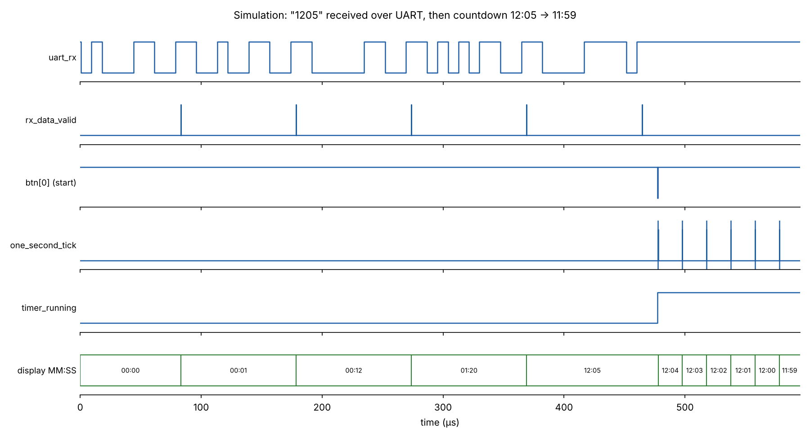
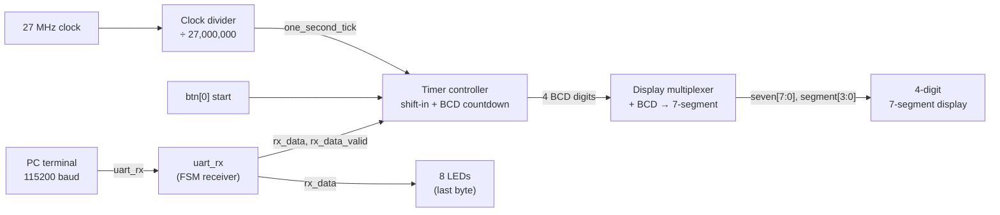

# Serial Countdown Timer on FPGA (Verilog, Tang Nano 9K)

A minutes:seconds countdown timer written in Verilog for the **Sipeed Tang Nano 9K** (Gowin GW1NR-9).
The start time is typed on a computer and sent to the board over **UART (115200 baud)**, the time is shown on a
**4-digit multiplexed 7-segment display**, and a push button starts a **1 Hz countdown** that stops at 00:00.

Course project for **CS 303 – Logic & Digital System Design**, Sabancı University (Spring 2026).



## Features

- **UART receiver** (8N1, 115200 baud) implemented as a finite state machine
- **Serial time entry:** digits `0`–`9` typed in a terminal shift into the display from right to left; other characters are ignored
- **1 Hz timebase** generated from the 27 MHz on-board clock with a 25-bit clock divider
- **BCD countdown with borrows** across the four digits (e.g. `12:00 → 11:59`, `10:00 → 09:59`)
- **Input validation:** invalid seconds such as `xx:75` are clamped to `xx:59` when the countdown starts
- **Time-multiplexed 7-segment display** (~100 Hz refresh) with a decimal point as the `MM.SS` separator
- **Received byte monitor:** the raw ASCII code of the last UART byte is mirrored on 8 external LEDs
- **Self-checking testbench** in Icarus Verilog (see [Simulation](#simulation))

## How it works

| Mode | What happens |
|---|---|
| **Setting** (idle) | Each digit received over UART shifts in: `MM:SS ← M S S new`. Sending `1`, `2`, `0`, `5` shows `12.05`. |
| **Countdown** | Pressing `btn[0]` starts the countdown if the display is not `00:00`. Every second the time decreases by one. |
| **Stop** | At `00:00` the timer stops automatically and new digits can be entered again. |
| **Reset** | The active-low reset button clears the display to `00:00` and stops the timer. |

### Architecture



### Modules

**`src/uart_rx.v` – UART receiver.**
A 5-state FSM (`IDLE → START → REC_BYTE → STOP → DATA`). The input is passed through two flip-flops and a falling
edge on the line marks the start bit. One bit lasts `CLK_FRE · 10⁶ / BAUD_RATE = 27,000,000 / 115,200 ≈ 234` clock
cycles, and each data bit is sampled in the middle of its bit period for noise margin. When a full byte has been
received, `rx_data_valid` is raised for one clock cycle.

**`src/serial_template.v` – top level.**
- *Clock divider:* a 25-bit counter counts to 26,999,999 and emits a one-cycle `one_second_tick`
  (24 bits would only reach 16,777,215, so 25 bits are required).
- *Timer controller:* four 4-bit BCD registers (`MM:SS`). In idle mode, valid ASCII digits (`0x30`–`0x39`) are
  converted to BCD by subtracting `0x30` and shifted in. In countdown mode the seconds-ones digit decrements on each
  tick and borrows ripple to the higher digits, wrapping seconds to 59 and minutes-ones to 9.
- *Display multiplexer:* only one digit is driven at a time. A 16-bit counter selects the next digit every
  2¹⁶ cycles ≈ 2.4 ms, so the whole display refreshes at ~100 Hz and looks continuously lit to the eye.

**`src/cs303.cst` – pin constraints** for the Tang Nano 9K.

| Signal | Pin(s) | Description |
|---|---|---|
| `sys_clk` | 52 | 27 MHz on-board oscillator |
| `sys_rst_n` | 4 | Reset button (active-low) |
| `uart_rx` | 18 | UART receive line |
| `btn[3:0]` | 74, 75, 76, 77 | Push buttons (`btn[0]` = start, active-low) |
| `segment[3:0]` | 28, 27, 26, 25 | 7-segment digit select |
| `seven[7:0]` | 33, 40, 41, 29, 30, 34, 35, 42 | 7-segment segments + decimal point |
| `led[7:0]` | 69, 68, 57, 56, 55, 54, 53, 51 | External LEDs (received byte) |

### Resource usage (Gowin EDA, GW1NR-LV9QN88PC6/I5)

| Resource | Used | Available | Utilization |
|---|---|---|---|
| Logic (LUT + ALU) | 248 | 8,640 | 3% |
| Registers (FF) | 101 | 6,693 | 2% |

## Simulation

The testbench `sim/tb_serial_template.v` drives real UART frames into the design and checks the results
automatically:

1. Reset clears the display to `00:00`
2. Digits sent over UART appear on the display, non-digit characters are ignored, the LEDs show the last byte
3. The countdown decrements correctly, including borrows (`12:00 → 11:59`, `10:00 → 09:59`)
4. The timer stops at `00:00` and does not underflow
5. Invalid seconds (`01:75`) are clamped to `01:59` on start
6. Reset during a running countdown clears the display
7. The clock divider produces exactly one tick every 27,000,000 cycles (1.000 s)

To keep the simulation fast, tests 3–6 inject the one-second tick directly instead of waiting 27 million clock
cycles per second; test 7 then checks the real divider once. In the waveform above, the ticks are therefore
~20 µs apart instead of 1 s.

```bash
# Requires Icarus Verilog (https://steveicarus.github.io/iverilog/)
iverilog -g2012 -o sim/tb.vvp sim/tb_serial_template.v src/serial_template.v src/uart_rx.v
vvp sim/tb.vvp

# Optional: redraw the waveform figure (pip install vcdvcd matplotlib)
python sim/plot_waveform.py sim/tb_serial_template.vcd docs/waveform.png
```

## Build and run on the board

1. Open `cs303_timer.gprj` in **Gowin EDA** (tested with V1.9.11.03 Education).
2. Run **Synthesize** and **Place & Route**.
3. Program the board with **Gowin Programmer** using the generated bitstream (`impl/pnr/cs303_timer.fs`).
4. Open a serial terminal at **115200 baud, 8N1**. We used **PuTTY** on Windows:
   - Connection type: **Serial**, serial line: the board's COM port (see Device Manager → Ports), speed: **115200**
   - On macOS / Linux, `screen /dev/tty.usbserial-XXXX 115200` works the same way
5. Type four digits (e.g. `0130` for 01:30), then press `btn[0]` to start the countdown.

## Possible improvements

Ideas for a next version:

- **Button synchronization and debouncing:** `btn[0]` is used directly in the clocked logic. Passing it through a
  two-flip-flop synchronizer and a debouncer would make the start input robust against metastability and contact bounce.
- **Restart the divider on start:** the 1 Hz divider runs freely, so the first second after pressing start can be
  shorter than one second. Clearing the divider when the countdown starts would make every second exactly 1 s.
- **Pause/resume and hours mode** using the remaining buttons and switches.

## Repository structure

```
├── src/
│   ├── serial_template.v      # top level: timer controller, clock divider, display multiplexer
│   ├── uart_rx.v              # UART receiver FSM
│   └── cs303.cst              # pin constraints (Tang Nano 9K)
├── sim/
│   ├── tb_serial_template.v   # self-checking testbench
│   └── plot_waveform.py       # draws docs/waveform.png from the VCD file
├── docs/
│   └── waveform.png
└── cs303_timer.gprj           # Gowin EDA project file
```
